         
  
> whoami

I'm a BCA student and full-stack developer working toward an AI Engineer role. I build applications where AI sits inside a real product: a React frontend, a Django or FastAPI backend, a database, authentication, and an LLM or voice layer on top.

What I care about is the engineering around the model: clean APIs, sensible data modelling, safe handling of user input, and architecture that can grow past a demo.

 
> what I build
<table> <tr> <td width="33%" valign="top"> <h3>🧠 AI &amp; LLM Applications</h3> Fitness, healthcare and recruitment products with LLM-driven workflows, plus retrieval pipelines (PGVector) for grounded answers. </td> <td width="33%" valign="top"> <h3>🎙️ Voice Assistants</h3> Voice agents built on FastAPI with telephony and real-time LLM integrations (Vapi, Twilio, Gemini). </td> <td width="33%" valign="top"> <h3>⚙️ SaaS &amp; Backend Systems</h3> REST APIs, JWT auth, validation, role-based access and multi-tenant thinking for EdTech, support and service platforms. </td> </tr> </table>  
> featured projects
🧠 AI, LLM & Voice Systems
<table> <tr> <td width="50%" valign="top"> <h4>🏋️ FitMitra / Fitty AI</h4> AI-powered fitness platform   Workout planning, diet guidance and an AI fitness assistant, aimed at personalised user experiences.   <code>React</code> <code>TypeScript</code> <code>Django REST</code> <code>MongoDB</code> <code>Gemini</code> </td> <td width="50%" valign="top"> <h4>🎧 Fitty AI Voice Coach</h4> Voice-based fitness coaching   Personalised workout generation with a safety-validation step, user management and voice-assistant workflows.   <code>FastAPI</code> <code>SQLite</code> <code>LLMs</code> <code>Voice / Telephony</code> </td> </tr> <tr> <td width="50%" valign="top"> <h4>🦁 LEO: Global Projects AI Voice Assistant</h4> Voice assistant for Global Projects   Real-time voice assistant with knowledge ingestion and retrieval workflows over a vector store.   <code>FastAPI</code> <code>Vapi</code> <code>Twilio</code> <code>Gemini Realtime</code> <code>PGVector</code> </td> <td width="50%" valign="top"> <h4>🧑‍💼 Aarohi: AI Recruiter</h4> Recruitment SaaS   AI-assisted recruitment workflows, designed around production-grade architecture: multi-tenancy, RBAC, auditability and privacy.   <code>Multi-tenancy</code> <code>RBAC</code> <code>Audit logging</code> </td> </tr> <tr> <td width="50%" valign="top"> <h4>🩺 ChikitsaAI</h4> AI-focused healthcare project   An AI-driven healthcare application exploring how LLMs can support health-related workflows. </td> <td width="50%" valign="top"> <h4>🛰️ NewsDetector &nbsp;·&nbsp; 🧪 NogenAI</h4> Content detection &amp; AI experiments   A news/content detection project and an AI-oriented build, part of my ongoing experiments with applied AI. </td> </tr> </table>
🏗️ SaaS, Full-Stack & Product Engineering
<table> <tr> <td width="50%" valign="top"> <h4>📚 Learnova</h4> Tuition management &amp; EdTech SaaS   Classroom teaching, student management, tests, progress tracking, homework monitoring and parent updates in one ecosystem.   <code>React</code> <code>TypeScript</code> <code>Express</code> <code>MongoDB</code> <code>JWT</code> <code>Zod</code> </td> <td width="50%" valign="top"> <h4>🎫 SupportPulse</h4> Ticketing &amp; email support system   Full-stack customer-support platform that turns email and tickets into a trackable workflow.   <code>Full-stack</code> <code>REST APIs</code> <code>Email workflows</code> </td> </tr> <tr> <td width="50%" valign="top"> <h4>🔧 Instant Mechanic Dashboard</h4> Service-workflow dashboard   Dashboard for an instant mechanic/service workflow, covering request handling and service operations. </td> <td width="50%" valign="top"> <h4>🤝 ShramSetu</h4> Work &amp; service platform   A project focused on connecting work and service-related workflows. </td> </tr> </table>

🔒 Most of these projects live in private repositories. I'm happy to walk through architecture, code and demos on request.

 
> tech stack

Layer	Technologies
Frontend	React.js TypeScript JavaScript HTML CSS Tailwind CSS
Backend	Python Django Django REST Framework FastAPI Node.js Express.js
AI & Voice	Gemini LLM integrations Vapi Twilio Retrieval / RAG pipelines
Data	MongoDB PostgreSQL PGVector SQLite SQL
Security & Validation	JWT RBAC Zod
Tooling	Git GitHub Postman REST APIs
   
  
> how I build
Product first. Start from a real workflow (a coach, a classroom, a support inbox), then choose the tech.
AI with guardrails. Validate model output, such as the safety checks in my fitness voice coach, instead of trusting it blindly.
Structure early. Typed frontends, validated inputs, authenticated APIs and clear role boundaries.
Keep improving. Every project is a chance to ship cleaner code than the last one.
 
> currently
text
🎯  Strengthening Data Structures & Algorithms
🏗️  Building production-ready full-stack and AI applications
📐  Learning software-engineering best practices and collaborative development
<!-- ===================================================================== HACKATHONS: UNCOMMENT ONLY AFTER YOU CAN PROVE THEM Public sources did not confirm these when this README was written. Add a certificate, official result page, or post link before publishing. ## `> highlights` 🏆 **Brewing Codes 4.0 Hackathon (MUIT Noida, 2026)** — <your verified result, e.g. "Prize winner, ₹35,000"> Project: <project name>. Link: <certificate or result URL> 🇮🇳 **Smart India Hackathon 2026** — Participant, Team Tech Nerds (Problem Statement SIH26196) (Describe as participation only, not as a win.) ===================================================================== -->  
> let's connect

<!-- Add your own links, then uncomment:   -->

  

Open to conversations about AI engineering, full-stack roles and collaborations.

 

